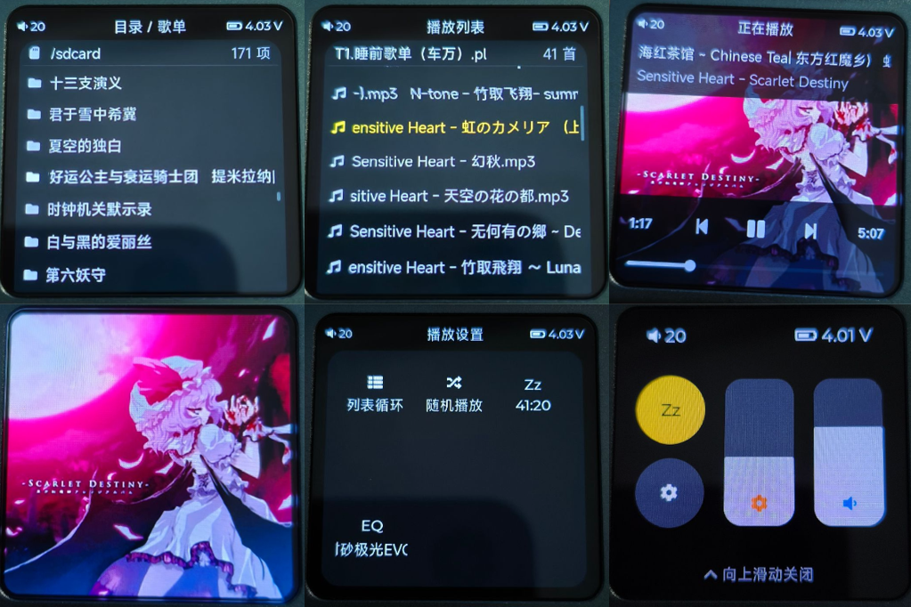

# NightPlayer（FakePodNano 版）

> 将 NightPlayer 的优秀体验带到 FakePodNano 播放器上——一款专注**本地音乐播放**的第三方固件。

**FakePodNano** 是由 B 站 UP 主「[萨那兰的黄昏](https://space.bilibili.com/18598545)」设计的开源成品播放器硬件（ESP32-S3 + AMOLED 触摸屏 + A/B 双物理按键 + TF 卡 + CS43131，[项目介绍视频](https://www.bilibili.com/video/BV1FKMQzSEvY/)、[开源硬件主页（嘉立创）](https://oshwhub.com/planevina/fakepodnano-lossless-audioplayer)）。本固件为其重写了以"听歌"为核心的整套体验：滑动浏览音乐库、全屏封面正在播放页、下拉控制中心，以及专为夜间场景设计的睡眠定时与息屏盲操作。

> **⚠ 目前仅支持 CS43131 版本硬件**：FakePodNano 另有 **PCM5102** 版本（耳放芯片不同），本固件**尚未真正支持**、也从未在实机验证过，**请勿刷入 PCM5102 版本的机器**，详见下方「📱 兼容设备」。

## 人类作者寄语

> 不得不说有了符合习惯的固件之后，从原来的吃灰变成了每天平均听三个小时起步

**截图展示**



> 从1到6分别是目录列表（左右滑动第一页）、歌曲列表（左右滑动第二页）、播放页面（左右滑动第三页）、播放页面（点击空白处隐藏控件）、设置界面（左右滑动第四页），以及下拉后显示的控制中心。

作者目前不能算是有嵌入式经验，什么I2C、什么I2S、什么数据结构全靠蓝色大肥鱼现场教学。

不过至少界面、交互逻辑和功能都是亲自把关设计的。几乎复刻了原版 [NightPlayer](https://gitee.com/ZYFDroid/NightPlayer) 的大部分操作体验。

具体功能可以参考下面AI写的使用说明和功能介绍，这里就不一一展开了。

如果你想要一个开机就能马上听歌、操作按键完善，或者你有大量按照分类整理好文件夹的MP3格式歌曲，或者喜欢睡前听歌，希望能够方便开启或者自动开启睡眠定时器的，或者你有一堆不同的耳机需要套用不同DSP参数的，都可以尝试一下这个固件。

## 它适合谁

1. **大型曲库：** 如果你有超大型曲库，例如 5000 多首，本固件的大曲库支持会非常适合你。准备一张 32GB 以上的卡（FAT32 / exFAT 均可），按文件夹把 MP3 拷进去，开机扫描即可——实测 8990 首的曲库，扫描约 4 秒、写入播放列表分区约 6 秒；之后每次开机直接读回，不再重扫（曲库有变动时，在设置菜单点一次「重新扫描」）。同级目录按名称前 4 个字符排序，用 `01_`、`02_` 之类的文件夹前缀就能控制顺序；除了文件夹，还支持 `.pl` 文本歌单（每行一个相对路径，记事本即可编辑）。

2. **想要封面和信息（需要电脑，可选）：** 配套的 Windows 单文件工具 `NightPlayerNanoInfoScanner.exe` 可以批量读取 MP3 标签，生成 `.npd` 元数据与 460×460 封面，播放页就能显示标题、艺术家/专辑和全屏封面，并顺带写入回放增益。工具是增量扫描，新增歌曲再跑一遍即可。**不扫描也完全不影响听歌**——标题回退为文件名、副标题回退为文件夹名、封面用内置默认图。

3. **睡前听歌：** 睡眠定时器支持 15~240 分钟，到点音量渐降后进入伪关机（屏幕关闭、DAC/触摸/SD 等外设全部停掉、芯片 deepsleep），实测可连续待机 3~4 天（视电池容量与健康度而定）。短按下键（B）即可唤醒并重启，长按上键（A）满 3 秒则由硬件彻底断电。还可在「设置 → 睡眠定时器 → 开机默认开启」里让它每次开机自动起表；定时期间的切歌/操作会按「清醒感知」自动加时（可关）。息屏后音乐照常播放，且支持黑屏盲操作：上键短按播放/暂停、下键短按下一曲、下键长按上一曲。另有低电拒启、低电压/暂停超时自动关机保护。

4. **多副耳机 / 多套听感：** 10 段浮点 PEQ + 预增益，直接兼容 NightPlayer 的 `.eq` 预设（放进卡根目录 `.musicfx/`，在播放设置页选择）；配合 SAVE1~SAVE4 四个配置槽位，每套槽位独立保存音量、循环/随机、睡眠定时、EQ 和当前歌曲，换耳机点一下就能整套切换。

5. **开源 / 二次开发：** 代码托管在 Gitee：<https://gitee.com/ZYFDroid/night-player-fake-pod-nano>，基于 MIT 协议，可自行修改，也可把代码用于其他项目（`components/` 下的屏幕/触摸驱动与 `lvgl_port.c` 来自原厂或第三方，遵循其原许可，不在 MIT 覆盖范围内）。

## 它不适合谁

1. **对功能有要求：** 本固件只有音乐播放功能。相对于原版固件，没有电子书阅读、图片查看、开机动画设置、视频播放、频谱显示和晃动切歌等功能。如果你需要这些，请使用原版固件，或者克隆代码自行二次开发。

2. **PCM5102 版本：** 作者手上只有 CS43131 版本的机器，PCM5102 版本从未实机验证，固件也尚未真正支持（构建矩阵里预留了 `pcm5102` 维度，但目前只影响启动日志，音频链路仍按 CS43131 初始化）。**PCM5102 版本的机器请不要刷。** 若你手里有相关硬件，可以克隆代码进行适配。

3. **无损格式：** 目前只解码 MP3（采样率 32k / 44.1k / 48kHz），FLAC、APE、WAV、ALAC 等都不支持。曲库以无损为主的话，需要先转成 MP3。

4. **没有电脑：** 本固件的曲库维护（封面/元数据扫描、`.pl` 歌单、批量整理）主要建议使用电脑进行；没有电脑也能听，但会失去封面与详细信息，维护曲库会变得很困难。

5. **其他硬件：** 显示、触摸、按键、DAC 都按 FakePodNano 的板子写死，只适用于 FakePodNano（CS43131 版）；其他 ESP32 播放器不能直接刷。

## ✨ 功能特性

### 🎵 播放与音乐库

- **本地 MP3 播放**，实测 5000+ 首的大曲库顺畅使用；
- 音乐按**文件夹**组织，另支持 **`.pl` 文本歌单**（每行一个音乐路径，在电脑上随手可编辑）；
- **循环模式**：全部循环 / 列表循环 / 单曲循环；**播放顺序**：顺序 / 随机；
- **无限随机播放**：随机序列由无数个"整轮排列"衔接而成——一轮内绝不重复、理论上可无限播放，还能一路"上一曲"回退，重启后随机现场原样恢复；
- **记忆播放**：记住上次播放的歌曲与状态，开机自动继续（关机前若已暂停，则开机只恢复歌曲、不突然出声）；
- 音量 **0~30 档**精细调节（0 静音），支持**回放增益**（需要通过电脑小工具扫描）；
- **EQ 均衡器**：10 段浮点 PeakEQ + 预增益，读取与 **NightPlayer 兼容的 `.eq` 预设文件**，可随时切换或关闭（详见下方"准备音乐"）；
- **封面与歌曲信息**：显示全屏封面、标题 / 艺术家等（可选：用附带的电脑端小工具预处理一次；不处理也能正常播放）；
- **睡眠定时**：15~240 分钟，到点**音量渐降**后自动关机；定时期间的操作会自动"续命"加时（清醒感知，可关闭）。

### 🖥️ 界面

- **四页滑动主界面**：目录/歌单列表 → 歌曲列表 → 正在播放 → 播放设置，左右滑动切换；
- 歌曲列表流畅滚动，**当前播放曲目高亮**——点目录看歌、点歌即播；
- **正在播放页**：全屏封面沉浸式设计，点击封面隐藏 / 呼出标题与控制栏，支持进度拖拽、时间显示、上一曲 / 播放 / 下一曲；
- **顶部状态栏**：音量档位、当前页面、电池电量（电压）一瞥即知；
- **下拉控制中心**：从顶部下拉呼出，含 iOS 风格**亮度 / 音量竖条**、音量与电量概览，以及睡眠定时器快捷开关和设置入口；
- **完整设置菜单**：自动息屏、睡眠定时详情、按键帮助、关于、重新扫描音乐库、开发者选项。
- **设置**：播放设置页（循环方式 / 随机播放 / 睡眠定时） 

### 🔋 电源与睡眠

- **息屏播放**：两个按键一起按切换息屏 / 亮屏；息屏时音乐照常播放，屏幕全黑进入低功耗；
- **黑屏盲操作**：息屏时不用亮屏也能控制——上键短按播放/暂停、下键短按下一曲，长按上一曲；
- **自动息屏**：无操作超时自动熄屏（10 秒 ~ 10 分钟可选）；
- **自动关机保护**：息屏且暂停超时自动关机；电池电压持续过低自动关机，避免过放；
- **优雅关机**：长按 A 键提示"正在保存…"并定格画面，继续按满 3 秒由硬件断电（与机器自带的 3 秒硬关机键衔接）；未断电前按 B 键可**取消关机**；
- **低电量拒启**：电压过低时开机停在充电警告屏，不带病工作。

### 🚀 智能开机引导

开机自动完成检查与引导：低电量 → 无 SD 卡 → 音乐库有变化则一键扫描（实时进度）→ 正常进入主界面。音乐变动后，也可随时在设置菜单里"重新扫描"。

## 🎮 操作说明

按键（A = 上键 / 电源键，B = 下键）：

| 按键 | 亮屏时 | 息屏时（黑屏盲操作） |
|---|---|---|
| A 短按 | 音量 +1 | 播放 / 暂停 |
| B 短按 | 音量 -1 | 下一曲 |
| B 长按 | 音量 -10 | 上一曲 |
| A 长按 | 关机（保存后等待断电） | 亮屏并显示关机提示，继续按住即断电 |
| A+B 双按 | 息屏 | 亮屏 |

触摸操作：

- 左右滑动切换四个页面；
- 点击目录 / 歌单查看歌曲，点击歌曲直接播放；
- 正在播放页点击封面，切换"沉浸模式"与控件显示；
- 从顶部状态栏向下拉，呼出控制中心（亮度 / 音量滑块）；
- 拖动进度条跳转播放位置。

## 🎵 准备音乐（TF 卡）

> **⚠ 关于 TF 卡与底噪**：底噪与 TF 卡本身质量/特性相关。个别质量较差的卡
> （尤其大容量老卡）在播放时可能引入可闻的"吱吱"底噪（高敏耳机下明显，
> 息屏后依然存在），固件侧无法消除——**遇到底噪请先换一张质量可靠的卡验证**。
>
> **实测黑名单（播放产生明显底噪）**：
> - **朗科 Netac 64GB**：实测息屏播放仍有约 -59dB 底噪（固件侧无法消除，换卡解决）
>
> **实测正常（可作为替代）**：
> - **致钛 ZhiTai 64GB**：实测亮屏/息屏底噪均低于听域，播放干净
>
> 详细实验记录见 `ideas_and_exps/底噪研究记录.md`。

1. 把 MP3 按文件夹放进 TF 卡——开机后整张卡的音乐目录都会被识别；
2. 想要**歌单**：新建一个 `.pl` 文本文件（放在根目录或 `playlists/` 文件夹），每行写一个音乐路径：

   ```
   musics/钢琴曲/01 夜曲.mp3
   musics/钢琴曲/02 月光.mp3
   ```

3. （可选）想要**封面与歌曲信息**（标题 / 艺术家、回放增益、全屏封面），用配套的电脑端小工具扫描一次，方法见下。

### 关于目录排序

本项目的目录逻辑是：
1. 从根目录扫描，若某个文件夹有.pl播放列表，则会先添加到目录列表中
2. 然后若该文件夹本身就有歌曲，则该文件夹也会加入到目录列表中
3. 若该目录有子文件夹，则回到第一步开始扫描子文件夹

表现就是扫描目录会按照深度优先的顺序，按顺序展示每一个有音乐文件的目录。同级目录按照前四个字符排序

### 🖼️ 电脑端封面 / 歌曲信息工具（可选）

固件自带的电脑端配套工具 **`NightPlayerNanoInfoScanner.exe`**（Windows 单文件程序，源码见 `related_project/MP3InfoScanner/`）能为整张卡的 MP3 批量提取标签信息，并生成播放页使用的元数据与 **460×460 封面**。不跑此工具也能正常播放，只是没有封面与详细歌曲信息。

**使用步骤：**

1. 先在播放器上关机（或安全断电），取出 TF 卡插到电脑上；
2. 把 `NightPlayerNanoInfoScanner.exe` 复制到 **TF 卡根目录**（工具会扫描 exe 所在目录及其所有子文件夹中的 MP3）；
3. 双击运行，点击「开始扫描」：
   - 界面实时预览当前歌曲封面，日志面板输出处理进度，按钮显示"扫描中：当前/总数"；
   - **扫描期间请勿关闭窗口**，等待提示"扫描完成"；
   - 完成后 TF 卡根目录下会出现隐藏文件夹 `.ecov/`，里面镜像存放着每首歌的元数据文件；
4. 之后新增了 MP3，把卡插回电脑再跑一遍即可——工具是**增量扫描**，只处理新增或更新的文件；
5. 安全弹出 TF 卡并插回播放器，开机后正在播放页即可显示封面与标题 / 艺术家信息（无需重新扫描音乐库）。

> 提示：没有内嵌封面或标签的 MP3 也能正常扫描（自动回退为文件名 / 默认信息）；工具需在 Windows 上运行，获取与编译方法见 `related_project/MP3InfoScanner/README.md`。

### 🎚️ EQ 均衡器预设（.eq 文件，可选）

固件内置 **10 段浮点 PeakEQ 均衡器**，预设文件格式与 **NightPlayer 原版完全兼容**，
可以直接沿用 NightPlayer 的 EQ 文件，无需转换。

**使用方法：**

1. 把 `.eq` 文件放入 TF 卡根目录的 **`.musicfx`** 文件夹（文件夹不存在则新建），例如：

   ```
   .musicfx/
     ZTYX.eq
     SoundCoreA30.eq
   ```

2. 插回播放器，在主界面滑到**播放设置页**（第 4 页），点左下角的 **「EQ」** 格；
3. 弹出预设列表：选择「无 EQ（关闭）」或任意 `.eq` 文件，点击即生效（当前生效项黄色高亮）；
4. 选择的 EQ 会**自动保存**（参数存入播放器内部），下次开机无需 SD 卡也会自动恢复。

**`.eq` 文件格式（与 NightPlayer 兼容）：**

```
0.6                    ← 第一行：预增益（0~1 之间的数字）
153,1.672240803,-13    ← 之后每行一段：fCenter(16~20000), fQ 的倒数(0.2~5), dBGain(-15~+15)
1169,1.483679525,-8.3
```

- 数字用**逗号**分隔，允许空格；空行忽略；
- 最多 **10 段**，超过或内容/参数非法会弹提示并拒绝应用（原样文件可对照
  `Q:\MP3Player\.musicfx` 中的示例）。

> 实现细节与调音参考：Desktop/Ctyx（床头音响）工程、`ideas_and_exps/EQ均衡器实现记录.md`。

> **格式限制**：目前仅支持 MP3，采样率 32k / 44.1k / 48kHz。

## 🔧 开发环境

1. 安装 **ESP-IDF 5.5.4 或 5.5.5**（默认路径 `C:\esp`）；
2. 从 **<https://gitee.com/ZYFDroid/idf-client-cli/releases/>** 下载 `idfc.exe`，放到 **PATH 里的某个目录**（例如 `C:\Users\<你>\ProgramFiles\bin\`）——这是本项目构建/烧录/监视的统一入口，**不要放进项目目录**（工作区带的低级完整性标签会让它无法启动服务器，详见 [AGENTS.md](AGENTS.md)）；
3. 在项目目录里启动一次构建服务（**普通权限即可，不需要管理员**）：
   ```powershell
   idfc start-server
   ```
4. 用 Deepseek Harness 打开本项目文件夹，在对话框输入"帮我构建这个项目"；
5. 设备连接电脑后，输入"帮我构建 release 并烧录到 COMx"（COMx 换成实际串口号）。

多配置说明见 [ideas_and_exps/BUILD_CONFIG.md](ideas_and_exps/BUILD_CONFIG.md)，也可以自己敲（都在项目目录下执行）：

```powershell
idfc build                       # 构建（默认调试版）
idfc build -t release            # 构建发布版（完整字体、调试全关）
idfc flash -p COMx               # 烧录（COMx 换成实际串口号）
idfc run -t release --monitor-wait-for "App started"   # 构建+体积+烧录+监视一条龙
idfc help --all                  # 全部命令与参数
```

### 🔤 刷字体（第一次安装 / 换字体时必做）

系统字体（Droid Sans Fallback，3.55 MiB，含 5 万+ 汉字）**不在固件里**，而是单独放在 flash 的
`font` 分区（`partitions.csv`：偏移 `0x800000`，4 MiB）。所以刷完固件之后，**还要用手边的
esptool 单独刷一次字体**：

```powershell
esptool.exe --chip esp32s3 --port COMx write_flash 0x800000 spiffs/system.ttf
```

- 约 30~40 秒（实测 33.4 秒）；结束时出现 `Hash of data verified.` 就说明写入无误
  （有些版本还会多打一行 `doesn't look like an image file` 的警告，同样是正常的）。
- **不刷也能开机**：界面会自动回退到编译进固件的位图字体，但生僻字、日文、韩文等会显示成方框。
- **换字体**：把新字体改名成 `system.ttf` 覆盖 `spiffs/system.ttf` 再刷一遍即可（文件要 ≤ 4 MiB）。
- 完整的刷入说明（校验方法、出错表现、分区上限、历史坑）见
  [ideas_and_exps/FONT_FLASH.md](ideas_and_exps/FONT_FLASH.md)。

> 为什么字体要单独刷？它 3.55 MiB，如果跟着每次 `idfc flash` 一起烧，每轮更新固件都要多花半分钟，
> 而字体几乎从不变化。因此分区表只**保留它的位置**，内容由 esptool 一条命令写入。

## 📱 兼容设备

本固件面向开源项目 **FakePodNano** 的成品播放器：ESP32-S3、460×460 圆角 AMOLED 触摸屏、A/B 双键、TF 卡。不同批次硬件可能存在差异，刷机前请先核对设备参数。

### ⚠️ 关于 PCM5102 版本：本固件目前**并未真正支持**

FakePodNano 存在**两种 DAC（耳放芯片）版本**：

| 版本 | 控制方式 | 本固件支持情况 |
|---|---|---|
| **CS43131** | I²C 控制（端口 0x30）+ I2S | ✅ 开发与实测均基于此版本 |
| **PCM5102** | 仅 I2S，无 I²C 控制 | ❌ **尚未支持**（未开发、未实机验证） |

- **PCM5102 版本的机器请不要刷本固件**：固件的音频链路完全按 CS43131 初始化（I²C 控制 + I2S 写入），而 PCM5102 没有对应的 I²C 控制端口，音频部分无法正常工作；且该版本从未在实机上验证过。
- 构建系统里虽然预留了 `pcm5102` 的构建维度（`idfc_buildconfig.json` 的 `dac_chip` 维度，见 [BUILD_MATRIX.md](ideas_and_exps/BUILD_MATRIX.md)），但**选它不会做任何真正的切换**：Kconfig 项 `CONFIG_AUDIO_DAC_PCM5102` 目前**只在启动日志里打印一行**

  ```
  DAC chip: PCM5102 (build-time selection only, real switching not implemented)
  ```

  音频初始化仍然走 CS43131 的路径。反过来，`CONFIG_AUDIO_DAC_CS43131` 与 `CONFIG_AUDIO_DAC_PCM5102` **同时开启或同时关闭都会直接编译报错**——这是有意为之，防止"构建配置没生效却静默烧出一版选错芯片的固件"。
- 真正的切换（跳过 CS43131 的 I²C 初始化与控制、按 PCM5102 调整 I2S 与时钟策略、把音量/静音改到 I2S 数据侧处理等）**尚未实现**；固件侧的配置约定见 [BUILD_CONFIG.md](ideas_and_exps/BUILD_CONFIG.md) §8。
- 如果你手上有 PCM5102 版本的设备并愿意协助验证，欢迎提 issue。

**FakePodNano 原始项目（硬件作者）：**

- 开发者：[萨那兰的黄昏](https://space.bilibili.com/18598545)（B 站）
- 项目介绍视频：<https://www.bilibili.com/video/BV1FKMQzSEvY/>
- 开源硬件主页（嘉立创）：<https://oshwhub.com/planevina/fakepodnano-lossless-audioplayer>

## 🗺️ 路线图

- 请参阅 [FUTURE_PLAN.md](ideas_and_exps/FUTURE_PLAN.md)。写进去的东西可能会实现，也有可能会被砍掉。

## 📚 更多资料

- `AGENTS.md` —— 面向开发者的完整说明（硬件、架构、构建配置、踩坑记录）
- `ideas_and_exps/` —— 各功能模块的设计文档（音乐库扫描、播放控制器、随机播放、开机流程、构建配置等）

## 📜 许可证

本项目采用 [MIT 许可证](LICENSE)（Copyright (c) 2026 ZYFDroid），完整条款见 `LICENSE` 文件。

> **适用范围说明**：本许可证仅覆盖本项目**自行编写**的代码与文档。`components/` 目录下的组件（AMOLED 显示、触摸驱动、I²C 总线等）以及 `main/core/ui/lvgl_port.c` 由原作者（FakePodNano 原厂固件作者）提供或由其提供的文件改编，版权归原作者所有，不适用本许可证，请遵循其来源项目的许可条款；`managed_components/` 为由 ESP 组件管理器拉取的第三方依赖，各自遵循其原始许可证。
